<p align="center"></p>

# NotesFloat

**Website:** [alhassan.raoufs.me/work/NotesFloat](https://alhassan.raoufs.me/work/NotesFloat)

A floating, Raycast‑Notes‑style window for **Apple Notes**. Press a shortcut and your notes appear above
everything, including full‑screen apps, then disappear again. Everything lives in Apple Notes, so it syncs
through iCloud to your other devices.

macOS has no way to make Apple Notes' own window float, so NotesFloat is its own small editor that reads
and saves your notes through Apple Notes.

## Features

- **Floats everywhere**: over full‑screen apps and on every Space, without taking focus from the app you're in.
- **Global shortcut**: **⌃⌥N** by default, changeable in Settings. Launch at login is optional.
- **Raycast‑style command panel** (**⌘K**): search every action with its shortcut.
- **Notes browser** (**⌘P**): searches titles *and* note contents, shows pinned notes first, and creates a
  note from your search when nothing matches.
- **Apple Notes formatting**: Title, Heading, Subheading, Body, Monostyled, bold, italic, underline,
  strikethrough, bulleted, dashed and numbered lists, nested lists, and links. It uses the same shortcuts as
  Apple Notes, and lists start automatically when you type `- `, `* ` or `1. `.
- **Stays in sync**: saves as you type and picks up edits made in Apple Notes or on your other devices.
- **Notes management**: pin, duplicate, move to a folder, delete (to Recently Deleted), copy as
  Markdown/text/HTML, export to Markdown/text/PDF, and copy a `notesfloat://` link.
- **Hide from screen sharing** (⌥⌘H), zoom, and a toggleable format bar.
- **Quick capture** (**⌃⌥⇧N**): adds the selected text (with Accessibility) or the clipboard to your capture note
  without opening the window. Also available in any app's **Services › Add to NotesFloat**.
- **Themes**: Apple Notes (default), Liquid Glass, Graphite and Paper. Pick one in Settings or ⌘K › Change Theme.
- **Guided setup**: a welcome guide walks through every permission on first launch (and again from Settings).
- **Automatic updates** via [Sparkle](https://sparkle-project.org). Turn checking and auto-install on or off in
  Settings › Updates.

## Install

1. Download the latest **NotesFloat‑x.y.z.dmg** from [Releases](../../releases), open it, and drag
   **NotesFloat** to **Applications**.
2. Open it. Release builds aren't signed with an Apple Developer ID, so macOS blocks the first launch. Go to
   **System Settings › Privacy & Security** and click **Open Anyway**, or run:
   ```sh
   xattr -dr com.apple.quarantine "/Applications/NotesFloat.app"
   ```
3. Follow the welcome guide: it asks for access to Apple Notes and, optionally, Full Disk Access.

After that, NotesFloat updates itself. (Versions before 0.3 don't include the updater, so install 0.3 manually once.)

Requires **macOS 26 or later**, on Apple silicon or Intel.

### Optional: Full Disk Access

Apple Notes tells other apps that checklists are plain bullet lists, so saving a checklist note from here would
turn its checklists into bullets. To stay safe, NotesFloat asks you to confirm (⌘E) before editing any note
with a list. With **Full Disk Access** (offered in the welcome guide, or Settings › Permissions), it reads Apple Notes' database,
**read‑only**, to:

- know exactly which notes contain checklists, so plain lists open ready to edit,
- show checklist items as ☐ / ☑,
- search note contents faster, and show the notes you pinned in Apple Notes.

All edits still go through Apple Notes itself.

## Shortcuts

| | |
|---|---|
| **⌃⌥N** | Show / hide (configurable) |
| **⌃⌥⇧N** | Quick capture (configurable) |
| **⌘K** | Actions |
| **⌘P** or **⌥⌘F** | Browse and search notes |
| **⌘N** / **⌘D** | New note / duplicate note |
| **⇧⌘P** | Pin note |
| **⌘R** | Reload from Apple Notes |
| **⌘[** / **⌘]** | Back / forward |
| **⌘O** | Open in Apple Notes |
| **⇧⌘C** / **⇧⌘E** / **⇧⌘D** | Copy as… / export… / copy deeplink |
| **⌘F** | Find in note |
| **⇧⌘T** / **⇧⌘H** / **⇧⌘J** / **⇧⌘B** / **⇧⌘M** | Title / Heading / Subheading / Body / Monostyled |
| **⌘B** / **⌘I** / **⌘U** / **⇧⌘X** | Bold / italic / underline / strikethrough |
| **⇧⌘7** / **⇧⌘8** / **⇧⌘9** | Bulleted / dashed / numbered list |
| **Tab** / **⇧Tab** | Indent / outdent list item |
| **⌃⌘↑** / **⌃⌘↓** | Move line up / down |
| **⇧⌘K** | Add link |
| **⌥⌘H** | Hide from screen sharing |
| **⌥⌘,** | Toggle format bar |
| **⌘0** / **⌘+** / **⌘-** | Actual size / zoom in / zoom out |
| **⌃X** | Delete note (moves to Recently Deleted) |
| **⌘,** | Settings |
| **Esc** / **⌘W** | Hide |

## Limitations

These come from what Apple Notes lets other apps do:

- **Checklists, tables, images, attachments, drawings, tags and mentions** can't be written back. Notes
  containing attachments, tables or images open read‑only (⌘O opens them in Apple Notes). Checklist notes ask
  for confirmation (⌘E) before editing, because they would become bullet lists.
- **Locked notes** can't be opened here.
- **Pins** you set in NotesFloat are local to the app; pins from Apple Notes are shown (with Full Disk Access) but
  can't be changed.
- Notes in legacy IMAP / Gmail accounts are only listed without Full Disk Access.

## Build from source

Requires Xcode 26 or later.

```sh
./build.sh               # build, self-test, install to /Applications and relaunch
./build.sh --no-install  # build and self-test only
VERSION=1.0.0 ./build.sh --package   # also create dist/ zip + dmg + checksums
```

The app icon is drawn by `Artwork/make-icon.swift` (`swift Artwork/make-icon.swift` regenerates
`Artwork/AppIcon.icns`). The only dependency is Sparkle, downloaded (version-pinned and checksum-verified) into `vendor/` by `build.sh`.
`main.swift` holds the window, editor and commands; `Notes.swift` the Apple Notes bridge, HTML conversion and
read‑only database access; `UI.swift` the command panel and toast; `Setup.swift` permissions, updates, settings
and onboarding; `Theme.swift` the themes.

## Releasing

Add your changes under **Unreleased** in [CHANGELOG.md](CHANGELOG.md), then rename that heading to the version
and date (`## [0.4.0] - 2026-11-15`), commit, and push a version tag. GitHub Actions builds a universal app, runs the self‑test, signs the update for Sparkle,
and publishes a release with the `.dmg`, `.zip`, checksums and `appcast.xml` (the update feed installed copies
read from the latest release):

```sh
git tag v0.3.0 && git push origin v0.3.0
```

Tags with a suffix, like `v0.3.0-beta.1`, are published as pre‑releases (not offered as updates).

Builds are code-signed with a self-signed identity, **NotesFloat Self-Signed**, rather than ad hoc. Every build
then shares one designated requirement, so macOS keeps NotesFloat's permissions (Apple Notes, Full Disk Access,
Accessibility) across updates. It isn't an Apple Developer ID, so Gatekeeper still asks on first open. Locally
it lives in `~/Library/Keychains/NotesFloat-signing.keychain-db`; in CI it comes from the secrets `SIGNING_P12`
(base64 `.p12`) and `SIGNING_P12_PASSWORD`. Releases fail without them.

Update signing uses an EdDSA key stored in the maintainer's login keychain (account
`me.raoufs.alhassan.NotesFloat`). Its public half is `SUPublicEDKey` in `build.sh`; the private half must be in
the repository secret `SPARKLE_ED_PRIVATE_KEY`, and the release fails without it. Before publishing, the build
checks the signature against the public key with `.github/verify-sparkle.swift`.

## License

[Apache License 2.0](LICENSE)
